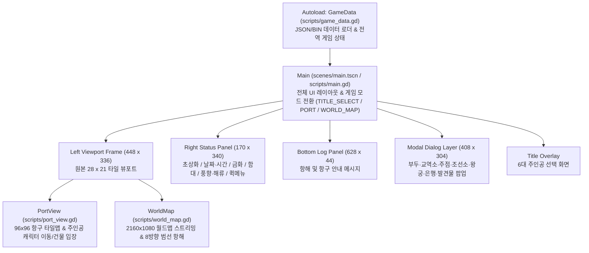

# 대항해시대 2 (Uncharted Waters 2) - Godot 4 아키텍처 및 데이터 구조 문서

본 문서는 원본 DOS 한글판(`DOS/*`)을 리버스 엔지니어링하여 구축한 **Godot 4.3 이식 프로젝트**의 디렉토리 구조, 런타임 아키텍처, 데이터 파이프라인 및 실행 방법을 설명합니다.

---

## 1. 빠른 실행 방법

프로젝트 루트(`/home/ycheo/uncharted-waters-2`)에서 아래 스크립트로 즉시 실행할 수 있습니다:

```bash
# 게임 바로 실행
./run.sh

# Godot 4 에디터(편집기) 모드로 열기
./run.sh -e
```

---

## 2. 디렉토리 및 파일 구조

```text
/home/ycheo/uncharted-waters-2/
├── project.godot              # Godot 4 프로젝트 설정 (640x400 -> 1280x800, Nearest 필터, GameData 오토로드)
├── run.sh                     # 게임 실행 래퍼 스크립트
├── ARCHITECTURE.md            # 현재 게임 아키텍처 및 구조 설명 문서
├── DOS/                       # 원본 대항해시대 2 DOS 한글판 파일 보존 폴더 (.gdignore 적용)
├── tools/
│   └── extract_assets.py      # 원본 DOS 바이너리(.LZW, .DAT, .MES, MAIN.EXE) -> PNG/JSON/BIN 추출기
├── assets/
│   ├── fonts/
│   │   ├── korean_font.ttf            # Godot 4 UI 및 맵 라벨용 한글 트루타입 폰트
│   │   └── all_font_16p_atlas.png     # 원본 ALL_FONT.16P에서 추출한 3,478자 16x14 비트맵 폰트 아틀라스
│   ├── portraits/
│   │   ├── kao_large_atlas.png        # KAO.LZW [0..127]: 64x80 인물 초상화 128종 시트
│   │   └── kao_small_atlas.png        # KAO.LZW [128..255]: 48x48 발견물 및 아이템 일러스트 128종 시트
│   ├── sprites/
│   │   ├── char_0.png ~ char_5.png    # CHAR.LZW [0..5]: 6대 주인공 16x32 보행 스프라이트 (투명 마스크 적용)
│   │   ├── char_6.png                 # CHAR.LZW [6]: 항구 일반 NPC 스프라이트
│   │   └── worldmap_ships.png         # DATA1.lzw [11] 후반부: 32x32 8방향 월드맵 범선 스프라이트 32종
│   ├── tilesets/
│   │   ├── port_tileset_0..6_*.png    # PORTCHIP.LZW: 7개 문화권 항구 타일셋 (day, dusk, night)
│   │   └── worldmap_tiles_*.png       # DATA1.lzw [11] 전반부: 월드맵 타일셋 (day, dawn, dusk, night, storm)
│   └── worldmap/
│       └── worldmap_minimap.png       # 2160x1080 전체 월드맵 오토타일링 복원 미니맵
├── data/
│   ├── worldmap_grid.bin      # 2160 x 1080 월드맵 최종 타일 ID 배열 (2,332,800 bytes)
│   ├── portmaps_bundle.bin    # 101개 항구 타일맵 (각 96 x 96 = 9,216 bytes)
│   ├── windcur.bin            # 계절별(하계/동계) 풍향·풍속 및 해류 데이터 (WINDCUR.DAT)
│   ├── ports.json             # 130개 항구(일반 100 + 보급항 30) 좌표, 타일셋, 통행 임계값, 12종 건물 입구 좌표
│   ├── discoveries.json       # 100개 발견물(COLONY.DAT + MAIN.EXE) 이름, 설명, 월드맵 좌표
│   ├── characters.json        # 120명 등장인물(6대 주인공 + 항해사/NPC) 능력치, 레벨, 초상화 ID, 초기 항구
│   ├── ships.json             # 23종 선박(MAIN.EXE) 가격, 적재량, 내구도, 선원 수, 추진력/선회력
│   ├── items.json             # 100개 아이템(MAIN.EXE + ITEM.MES) 명칭, 가격, 판매 항구, 상세 설명
│   └── palettes.json          # MAIN.EXE에서 추출한 시간대/장면별 16색 VGA 팔레트
├── scenes/
│   └── main.tscn              # 메인 게임 씬 (루트 Control 노드)
└── scripts/
    ├── game_data.gd           # [Autoload: GameData] 정적 데이터 로더 및 플레이어/함대/시간/경제 상태 관리
    ├── main.gd                # 메인 컨트롤러, 주인공 선택 화면, 우측 상태창, 하단 로그, 건물 내부 메뉴 모달
    ├── port_view.gd           # 항구 탐색 뷰포트 (96x96 타일맵, 주인공 4방향 보행, 건물 충돌 및 입장 감지)
    └── world_map.gd           # 월드맵 항해 뷰포트 (2160x1080 스트리밍 렌더링, 동서 세계일주 래핑, 입항/발견물)
```

---

## 3. 런타임 아키텍처 및 노드 계층 구조



### 핵심 컴포넌트 역할

1. **[`GameData`](file:///home/ycheo/uncharted-waters-2/scripts/game_data.gd) (Autoload 싱글톤)**
   - 게임 시작 시 `data/*.json`과 바이너리 맵(`worldmap_grid.bin`, `portmaps_bundle.bin`, `windcur.bin`), 그리고 모든 타일셋·스프라이트·초상화 PNG 및 한글 폰트(`korean_font.ttf`)를 메모리에 캐싱합니다.
   - 현재 선택된 주인공(`protagonist_id`), 항구(`current_port_id`), 월드맵 선박 좌표(`world_tile_x, world_tile_y`), 보유 금화/예금, 함대 선박 상태(`fleet_ships`), 날짜 및 시간(`year, month, day, hour_of_day`)을 관리합니다.
   - 시간대(`dawn`, `day`, `dusk`, `night`)에 따라 항구 및 월드맵이 사용할 팔레트 타일셋 키를 반환합니다.

2. **[`Main`](file:///home/ycheo/uncharted-waters-2/scripts/main.gd) (`scenes/main.tscn`)**
   - 원본 대항해시대 2의 화면 구성을 그대로 재현합니다:
     - **좌측 메인 뷰포트 (`448×336`, `28×21` 타일)**: 항구 내부(`PortView`) 또는 세계지도 해상(`WorldMap`)을 표시합니다.
     - **우측 상태 패널 (`170×340`)**: 주인공 초상화, 현재 위치, 날짜/시간, 금화/예금, 기함 내구도/선원/식량/식수, 풍향/해류 및 6개 퀵메뉴 버튼(`인물정보`, `함대/화물`, `발견물도감`, `세계지도`, `항구이동`, `주인공변경`)을 제공합니다.
     - **하단 메시지 바 (`628×44`)**: 입항·출항·암초 경고·탐색 결과를 출력합니다.
     - **모달 다이얼로그 (`408×304`)**: 항구 건물 진입 시 NPC 초상화(`KAO.LZW`)와 함께 건물 기능(교역품 매매, 선원 모집, 선박 수리/구입, 출항/보급, 숙박, 은행 거래, 발견물 보고 등)을 수행합니다.

3. **[`PortView`](file:///home/ycheo/uncharted-waters-2/scripts/port_view.gd)**
   - `ports.json`의 `chip_no`(`0..6`)와 현재 시간대(`day/dusk/night`)에 맞는 `port_tileset_{chip_no}_{tod}.png`를 사용해 `96×96` 항구 타일맵을 렌더링합니다.
   - `PORTCHIP.LZW` 홀수 엔트리에서 추출한 `walkability_thresholds` 및 출입문 타일(`0x16, 0x17`) 판정을 통해 원본과 동일하게 도로/다리/광장만 걸어 다닐 수 있도록 충돌 처리를 수행합니다.
   - `ZA_DAT.DAT`에서 추출한 12종 건물 좌표로 걸어 들어가거나 근처에서 `Enter`/`Space`를 누르면 `building_entered` 시그널을 발생시켜 해당 건물 메뉴를 엽니다.

4. **[`WorldMap`](file:///home/ycheo/uncharted-waters-2/scripts/world_map.gd)**
   - `2160×1080` 타일 규모의 `worldmap_grid.bin`을 선박 주변 `28×21` 타일 영역만 고속 렌더링하며, 가로 좌표(`x = 0 ↔ 2159`)를 `posmod()`로 래핑하여 지구를 한 바퀴 도는 세계 일주 항해를 지원합니다.
   - `MAIN.EXE` `0x39b93`에서 역분석한 항해 가능 해수면 타일(`0x00, 0x41, 0x49, 0x51, 0x59, 0x74..0x7f`) 판정을 적용합니다.
   - 항구 좌표(`world_x, world_y`)에 진입하면 즉시 해당 항구의 `PortView`로 입항하며, 해안가에서 발견물 좌표(`discoveries.json`) 근처를 탐색하면 원본 일러스트(`KAO.LZW` `128 + id`)와 함께 발견물 팝업이 열립니다.
